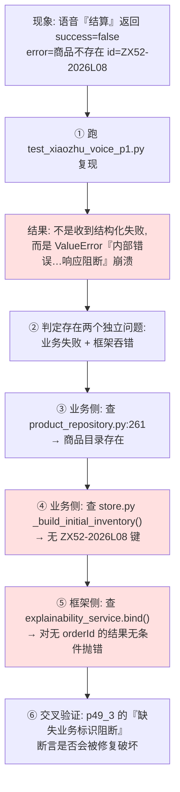
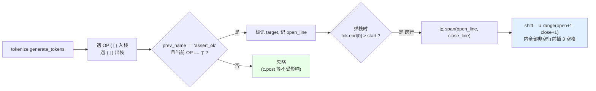
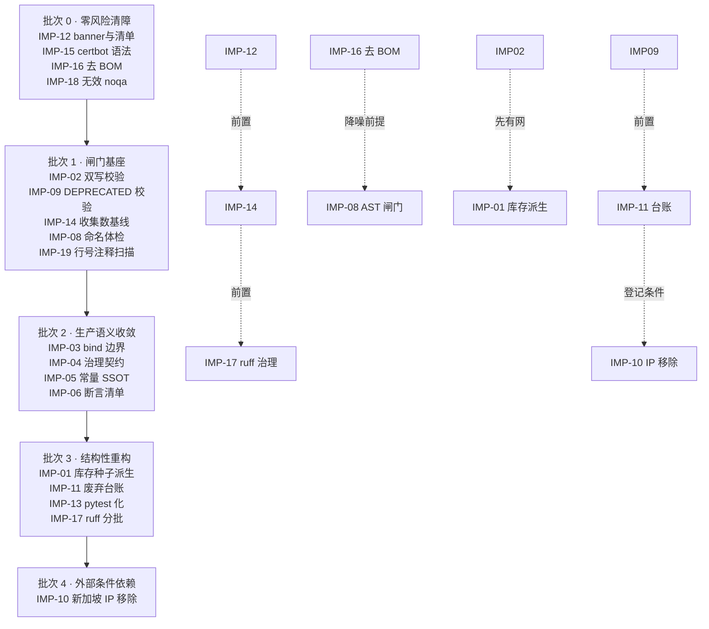

# 架构修复复盘报告（2026-10-27 轮次）

> 版本：v1.1　　日期：2026-10-27　　类型：Postmortem / 复盘（v1.1 增补 §10 改进项落地计划）
>
> 配套文档：`语音交互修复与多模型接入优化总结报告-20261027.md`（交付视角）
>
> 本报告视角：**问题是怎么被定位的、方案是怎么被选中的、验证证据链是否闭合、过程中犯了哪些错**。交付结果数据不重复展开，只在必要处引用。

---

## 0. 复盘范围与方法

### 0.1 范围

本轮 5 项任务：语音交互故障修复、两模型接入 Trae CN、新加坡 IP 废弃标记、record→assert 语义重构、全量回归。

### 0.2 复盘方法

按「**问题 → 定位路径 → 关键证据 → 误判与修正 → 方案取舍 → 验证闭合**」六段式逐项拆解，并单独设立 **§6 执行过程自身失误复盘**（这是本轮信息密度最高的部分）与 **§7 根因归类**。

### 0.3 一句话结论

5 项任务全部闭环、全仓 pytest 与基线逐项一致（2309 passed / 197 skipped）；但过程中出现 **1 次需要 git 回退重做的实施事故**、**4 类工具/环境误判**，其中 3 类可通过流程约束彻底消除。真正的技术难点不在「改代码」，而在**如何在 4000+ 文件、大量同名符号、脚本式测试并存的老仓库里，保证批量改动的语义零漂移与影响面零外溢**。

---

## 1. 问题一：语音「结算」失效

### 1.1 问题分级

| 维度 | 评估 |
|---|---|
| 严重度 | **P0**（核心交易链路：加购→结算失败，用户无法完成下单） |
| 影响面 | 特定 SKU（`ZX52-2026L08`，2026-10-19 上架的 52° 经典款）；但缺陷模式可复现于**任何后续新增商品** |
| 隐蔽性 | **高**——加购环节完全成功，失败发生在结算阶段4，且真实错误被框架层二次包装 |

### 1.2 定位路径（实际排查顺序）



### 1.3 关键证据与推理链

**证据 1（业务层）**：`product_repository.py:261` 有 `ZX52-2026L08` 目录条目（¥468，2026-10-19 上架），`store.py` 的 `_build_initial_inventory()` 中该键缺失 → `inventory_repo.get(pid)` 返回 `None` → checkout 阶段4 抛 `StageError("商品不存在")`。

**推理关键**：加购成功而结算失败，说明**两个环节读的是不同数据源**（加购读商品目录，结算读库存表）。若只看单一环节会误判为「结算逻辑 bug」。这是典型的**跨仓储数据一致性缺陷**，而非算法缺陷。

**证据 2（框架层）**：`xiaozhu_explainability_service.bind()` 在 `extract_business_id()` 取不到 id 时无条件抛 `ValueError`。失败响应本就不该有 orderId，因此该分支对失败场景是**必然误触发**。

**证据 3（同类缺陷已发生过）**：`store.py` 中已存在一条针对同类问题的进化注释（另一 SKU 的「目录新增但库存种子未同步」）。这说明该缺陷**不是偶发，而是流程性漏洞**——新增商品缺少「目录 + 库存种子」双写的强制检查。

### 1.4 误判与修正

| 时刻 | 初判 | 修正 | 修正依据 |
|---|---|---|---|
| 首轮 | 认为是 checkout 阶段机的错误处理不当 | 阶段机行为正确（库存缺失就该失败），真正的问题是**数据缺失** | 读 `_build_initial_inventory()` 发现键确实不存在 |
| 中期 | 认为 `bind()` 抛错是「可溯源铁律的正常执行」 | 铁律**只应约束已成功的写**；对失败响应抛错属于治理层过度约束，会吞掉真实业务原因 | 铁律的立论前提是「状态变更需可溯源」，失败响应无状态变更 |
| 后期 | 担心修复 `bind()` 会破坏 `test_xiaozhu_p49_3` 的阻断断言 | 不冲突：该断言场景的结果**无 `success` 字段**，`.get("success")` 返回 `None` ≠ `False` | 实读 `p49_3.py` L139-145 + 跑通 29/0 |

### 1.5 方案取舍

**缺陷 A 的三个备选方案：**

| 方案 | 描述 | 决策 | 理由 |
|---|---|---|---|
| A1 | 只补 `ZX52-2026L08` 一个库存键 | ❌ | 治标；同类缺陷已发生过一次，还会再发生 |
| **A2** | **补齐库存键 + 同步 docstring/库位计数注释** | ✅ **采用** | 治本且改动最小；注释同步避免下次维护者再被「12 款」误导 |
| A3 | 改造 `_build_initial_inventory()` 为「从 product_repository 自动派生库位」 | ❌ | 架构上更优，但超出本轮范围、影响面大（13 款商品的库存数/reserved 语义需重新设计），应单独立项 |

> **遗留建议**：A3 是正确的长期方向，已记入 §8 改进项。当前 `stock: 300` 为对齐同批次新品的经验值。

**缺陷 B 的方案：** 在 `bind()` 中对 `success is False` 提前 `return {}`。刻意选择**精确判定 `is False`** 而非 `not result.get("success")`——后者会把「无 success 字段」的合法阻断场景（p49_3 断言依赖）一并放行，造成可溯源铁律失效。这个细节是本次修复不引入回归的关键。

### 1.6 验证闭合

- `test_xiaozhu_voice_p1`：**崩溃 → 15/0**（直接证据）
- `test_xiaozhu_p49_3`：**29/0**（阻断能力未被削弱的反向证据）
- `test_redis_integration.py`：库存计数断言 15→16 同步，全仓 pytest 通过（连带影响面已覆盖）

---

## 2. 问题二：`test_xiaozhu_p49_4` 既有失败（TTL 断言过期）

### 2.1 问题性质

这不是本轮引入的缺陷，而是**回归过程中暴露的既有失败**：`p49_4` 修复前 40/1。

### 2.2 定位路径

失败项指向 `CONFIRM_TOKEN_TTL`。查证链条：

1. `xiaozhu_executor.py:46` → `CONFIRM_TOKEN_TTL = 300`
2. `git log` / `git blame` → 提交 `fb95a0fd`（v113）有意从 60 放宽到 300
3. 提交说明与现场实证：真机 TTS 播报 6-8s + 用户读码 + X5 设备逐格输入，实测超 60s
4. 安全性评估：一次性令牌 + 3 次码错上限 + 会话绑定三重兜底，放宽不降低安全等级

**结论**：生产代码的放宽是**有意且合理**的，测试断言未同步属测试侧欠债。

### 2.3 方案取舍

| 方案 | 决策 | 理由 |
|---|---|---|
| 把 `CONFIRM_TOKEN_TTL` 改回 60 让测试通过 | ❌ **明确否决** | 为迁就过期断言而回退有意的生产决策，是本末倒置，且会重新引入真机超时故障 |
| **同步测试断言到 300，并写明放宽依据** | ✅ **采用** | 断言应跟随已论证的生产决策；注释保留决策依据防止再次被"改回去" |

同步范围：`p49_1` L119-123（`== 300`）、`p49_4` L286+（`CONSENT_TOKEN_TTL <= 60 and CONFIRM_TOKEN_TTL <= 300`）。**consent TTL 保持 60 不动**——只有 confirm 环节涉及真机播报与人工输入，consent 是即时确认。

### 2.4 复盘要点

**「测试失败」不等于「代码有 bug」。** 判定前必须查 git 历史确认生产值是否有意变更。本轮若未查 `fb95a0fd` 而直接改回 60，会制造一个真机复现的 P1 故障。

---

## 3. 问题三：两模型接入 Trae CN

### 3.1 问题定位（前置调研）

接入前必须先回答三个问题，任一答错都会导致接入无效：

| 问题 | 查证方式 | 结论 |
|---|---|---|
| 两模型是否与 qwen 同源？ | 用户提供的百炼控制台「我的订阅」截图 | 同属华北2·北京 **TokenPlan** 订阅 → **共用同一 API key 与 base_url** |
| 条目该写到哪里、写几份？ | `dump_qwen_entry.py` 导出 qwen 条目全字段 + 遍历 state.vscdb | model_list_map 存在**两个 key**（`_AI.agent...` 与 `:AI.agent...`），共 **17 个 agent group**，缺一即部分场景不可用 |
| ak 能否复用？ | 读取 qwen 条目 ak 字段 | 长度 192 的 `safeStorage` 加密密文，**只能在 Trae 进程内解密** |

### 3.2 方案取舍

| 方案 | 决策 | 理由 |
|---|---|---|
| 让用户在 Trae UI 手动添加两次自定义模型 | ❌ | 手工添加默认只进当前 group，难以保证 17 个 group 全覆盖；且 UI 添加的字段（`config_source`、`max_turns`、`features.provider`）易与范式不一致 |
| **深拷贝 qwen 条目 + 差异化覆写 3 个字段，幂等写入两个 key** | ✅ **采用** | 严格复刻已验证可用的范式，最大限度规避兼容问题；`name`/`display_name`/`custom_model_id` 三项差异明确 |

差异化字段仅 3 项，其余 20+ 字段（`multimodal`、`builder`、`client_connect`、`max_turns`、`auth_type`、`icon`、`features`、`base_url`、`ak`）**全部继承**，这是「严格遵循 qwen3.8-max 标准接入范式」的落地方式。

### 3.3 关键失误与修正

**sqlite UPDATE 静默 0 行**：首次写库执行成功、无异常，但复核发现条目未落盘。根因是 **TEXT 列传入了 `bytes`**，SQLite 类型不匹配导致 WHERE 不命中，UPDATE 影响 0 行且不报错。

> **教训**：SQLite 的 UPDATE/DELETE 必须**校验 `cursor.rowcount`**，静默 0 行是最危险的失败模式（无异常、无日志、看似成功）。修正后一律传 `str` 并断言 rowcount > 0。

### 3.4 验证闭合与不可验证项的诚实处理

```
matched keys: 2
  groups: 7  | {'qwen3.8-max': 7,  'deepseek-v4.1-flash-1017': 7,  'glm-5.3': 7}
  groups: 10 | {'qwen3.8-max': 10, 'deepseek-v4.1-flash-1017': 10, 'glm-5.3': 10}
```

**连通性探测返回 HTTP 401 `Invalid API-key`** —— 这是本轮唯一「无法在 Agent 侧完成闭环验证」的项。处理方式：

- 不粉饰为通过。明确 401 的成因是 ak 为 safeStorage 密文、外部脚本无法解密，**属预期而非缺陷**；
- 401 响应带 request id 与结构化错误体 → **反证端点可达、路由与请求格式正确**（若 base_url 或模型名错误，返回的会是 404 / `model not found`）；
- 将「重启 Trae CN + 实际对话一次」列为**交付给用户的唯一阻塞验证项**，并写明回滚点 `state.vscdb.bak-20261027`；
- 附带风险提示：**重启前勿在 UI 改模型设置**，否则内存态回写会覆盖直接写库的条目。

> **复盘要点**：遇到验证边界时，正确做法是「说清边界在哪、给出边界内最强的间接证据、把剩余验证动作明确移交」，而不是伪造通过或含糊其辞。

---

## 4. 问题四：新加坡 IP 废弃标记

### 4.1 需求辨析

用户表述为「配置清理」，但同时明确「本次修改暂不删除，仅做标记待后续清理」。**这不是清理任务，是标记任务**——需求辨析错了会导致删除 35 处生产 SSH 目标、直接打断迁移过渡期的运维能力。

### 4.2 定位与影响面评估

全仓 rglob `*.py`（排除 `.git/node_modules/__pycache__/.venv/venv/dist`）+ `ast.parse` 语法校验 + IP 字面行分类：

```
py scanned: 4043 | syntax errors: 8 | marked IP lines: 35 | unmarked IP lines: 13
```

**分类决策**——48 处 IP 出现并非都该标记：

| 类别 | 处数 | 是否标记 | 理由 |
|---|---|---|---|
| 生产 SSH/部署/巡检脚本的实际连接目标 | 35 | ✅ 标记 | 迁移完成后需整行移除 |
| docstring 用法示例 | 6 | ❌ | 文档字符串，移除代码时示例也应改写而非删除 |
| 测试 mock 数据 | 3 | ❌ | 不是真实连接，删了会破坏测试 |
| print 提示文案 | 1 | ❌ | 面向用户的输出文本 |
| 工具脚本自身的 TARGETS/常量 | 2 | ❌ | 标记工具的自指 |

### 4.3 方案取舍

| 方案 | 决策 | 理由 |
|---|---|---|
| 用正则批量在含 IP 的行前插注释 | ❌ | 无法区分上述 5 类，会误标记 docstring/mock/工具自指 |
| **显式 TARGETS 白名单（35 项，1-based 行号）+ IP 字面校验 + 倒序插入** | ✅ **采用** | 精确可控；IP 校验不符即 SKIP，防止行号漂移导致标记错行；倒序插入保证前面的行号不因插入而失效 |

标记文本刻意写成**自解释指令**（`废弃事实 + 暂留原因 + 后续清理动作`），使未来任何维护者读到该行即可自主决策，无需回溯本次会话上下文。

### 4.4 失误与修正

| 失误 | 修正 |
|---|---|
| 首版 `verify_sg_marks.py` 以 `zhuxiang-jiu` 为 git 根拼接路径 → 全部找不到文件 | 改为 rglob 全仓扫描；确认**真实 git 根是 `d:\网站架构设计`**，`git diff/show` 输出路径带 `zhuxiang-jiu/` 前缀 |
| `mark_sg_deprecated.py` 注释误写「0-based 行号」，实际实现是 1-based | 修正注释（实现无误，注释误导） |

### 4.5 验证闭合

- 插入输出 `inserted marks: 35`，**零 SKIP**（说明 35 项行号与 IP 字面全部命中，无漂移）
- 复验 `marked 35 / unmarked 13`，13 项逐一归类确认为既定排除项
- `syntax errors: 8` 全部为既有（**7 个** U+FEFF BOM 文件 + `ecs8147-certbot.py:2`），**不在改动清单内**
  - 〔批次 0 修正〕BOM 文件实测为 **7 个而非 6 个**，详见 §10.9.3；该 7 个已于 IMP-16 全部清零，certbot 已于 IMP-15 处置，syntax errors 现为 **0**
- git diff 抽查确认注释位置与缩进正确，含 `drama84_batch.py` 的**括号内续行**这一最易出错的合法案例

---

## 5. 问题五：record → assert 语义重构（★本轮最大实施事故）

### 5.1 需求辨析：哪 5 个函数？

用户说「指定的 5 个函数」但未列名。通过全仓 grep `^\s*def record\(` 实证，**签名为 `(name, ok, detail="")` 的生产实证脚本恰好 5 个** —— 数量与用户所述吻合，据此确认范围。

**这一步是整个任务的风险闸门。** 仓库里存在大量同名 `record`：

| 同名符号 | 数量级 | 为何必须排除 |
|---|---|---|
| `def record(name, passed, detail="")`（测试计数） | 数十个 `test_*.py` | 签名不同，非指定范围 |
| `test_authmode_stage_a.py:25` | 1 | **签名相同但属测试脚本**，不在指定的 5 个之内——最危险的近似匹配 |
| `agent75_orchestrator_service.py:261 def record(self, model_id, task_type, ...)` | 1 | **业务领域方法**，语义就是「记录」，改成 assert 是语义破坏 |
| `blogger_source_adapter.py:84 def record(self, platform, ok)` | 1 | 同上 |
| `prod_traffic_e2e.py` 的 `/api/traffic/lead/record` | 1 | **URL 端点字符串**，改了直接 404 |

> 若用 `\brecord\b` 全局替换，将同时破坏业务方法、URL 端点与数十个测试脚本。**范围界定错误比实现错误后果严重得多。**

### 5.2 首轮实施事故（两个副作用）

首轮脚本落盘后检查发现两处问题，**决定 git 回退重做**而非打补丁：

| 副作用 | 表现 | 根因 |
|---|---|---|
| **① 注释被误改** | NEW_DEF 注释里的字面 `record(记录)` 被改成 `assert_ok(记录)`，语义荒谬 | 先替换 def 块、再跑 `re.subn(r'\brecord\(')`，subn 把新写入的注释也改了 |
| **② 续行缩进漏改** | 13 处 `in (` / `or` 嵌套对齐的续行未位移，虽不报错但破坏对齐 | 只处理**严格等于旧对齐列**（`name_col+7`）的行；嵌套续行的对齐基准不是该列 |

**为什么选择回退重做而非打补丁：**

- 副作用②是**分散的、位置不可枚举的**（13 处分布在 5 个文件的不同嵌套形态中），打补丁需要逐处定位，出错概率高于重写；
- 已写入的补丁脚本 `fix_assert_side_effects.py` 本身成为风险源（后续误运行会二次破坏）；
- `git checkout --` 回退成本极低（5 个文件无其他改动混杂）。

> **教训**：批量文本改造出现**非局部化**副作用时，回退重做的期望成本低于打补丁。补丁脚本用完必须删除。

### 5.3 重做方案（两阶段）

**Pass A（改名）—— 用顺序规避副作用①：**

1. **先** `re.subn(r'\brecord\(' → 'assert_ok(', body)`（此时 NEW_DEF 尚未写入，注释不可能被误伤）
2. **再** `body.replace(OLD_DEF, NEW_DEF, 1)`

前置守卫：`if body.count("record") != n_total - n_call: raise`（确保不存在非调用式 `record` 残留）、`if OLD_DEF not in body: raise`。

**Pass B（缩进）—— 用 tokenize 根治副作用②：**



关键设计：**统一位移而非按对齐列匹配**。`assert_ok(` 比 `record(` 长 3 字符，跨行调用内部**所有**续行（无论其对齐基准是括号列、`in (` 列还是 `or` 列）都必须整体 +3，才能保持相对对齐。

括号不匹配/未闭合 → `RuntimeError`；保留 BOM 与 CRLF/LF 原样回写。

**执行结果：**

```
prod_e2e_jwt_paradigm.py:         17 处, def 1, 跨行 13 个, 续行 +3 共 16 行
prod_synapse_gradation_verify.py:  19 处, def 1, 跨行 16 个, 续行 +3 共 48 行
prod_zjian_gradation_verify.py:    14 处, def 1, 跨行 12 个, 续行 +3 共 27 行
prod_zyh_e2e.py:                  19 处, def 1, 跨行 14 个, 续行 +3 共 20 行
prod_zyh_gradation_verify.py:      18 处, def 1, 跨行 15 个, 续行 +3 共 38 行
合计: 调用点 87, def 5, 缩进行 149
```

### 5.4 方案取舍：为什么是「非中断式断言」而非 Python `assert`

| 方案 | 决策 | 理由 |
|---|---|---|
| 改用原生 `assert cond, msg` | ❌ | 首败即抛 `AssertionError`，**后续实证项全部不执行**；生产实证脚本的价值恰在「一次跑完全链路、汇总所有失败点」 |
| **`assert_ok(name, cond, msg="")` 非中断式（失败仅计数）** | ✅ **采用** | 语义上是断言，行为上保持全链跑完 + 末尾 `raise SystemExit(1 if FAIL else 0)` 收敛退出码 |

形参一并统一：`ok`→`cond`（断言条件）、`detail`→`msg`（断言消息，对齐 `assert` 的语义习惯）。**运行时行为零变更**，这是「语义重构」而非「逻辑重构」的边界。

### 5.5 验证闭合（四层证据）

| 层 | 手段 | 结果 |
|---|---|---|
| 语法 | `python -m py_compile` 5 文件 | `exit=0` |
| 规范 | `python -m ruff check` 5 文件 | `All checks passed!`（+3 位移未触发任何 E501） |
| 完整性 | 残留核查 | 每文件 `record` 恰 1 处（进化注释有意保留的「record(记录)」）、`assert_ok` def 恰 1 处、调用点 16/18/13/18/17 |
| **语义** | **AST 等价性证明** | **5/5 PASS** |

**AST 等价性证明的方法论**（本轮最有复用价值的资产）：

```
git show HEAD:{rel} → ast.parse → NodeTransformer 把 record 改名 assert_ok
→ ast.unparse → 剔除 name ∈ {record, assert_ok} 的 FunctionDef（签名形参改名属预期差异）
→ 与工作区版本同样处理 → 比对 ast.dump(..., include_attributes=False)
```

`include_attributes=False` 排除行号/列号，因此**只比较语法结构与实参内容，不比较排版** —— 正好匹配「缩进变了但语义没变」的验证目标。

```
[PASS] prod_e2e_jwt_paradigm.py:         HEAD record( = 17, def = 1, 调用点 = 16, AST 体等价 = True
[PASS] prod_synapse_gradation_verify.py: HEAD record( = 19, def = 1, 调用点 = 18, AST 体等价 = True
[PASS] prod_zjian_gradation_verify.py:   HEAD record( = 14, def = 1, 调用点 = 13, AST 体等价 = True
[PASS] prod_zyh_e2e.py:                  HEAD record( = 19, def = 1, 调用点 = 18, AST 体等价 = True
[PASS] prod_zyh_gradation_verify.py:     HEAD record( = 18, def = 1, 调用点 = 17, AST 体等价 = True
结论: 全部等价通过
```

> **为什么 AST 等价比「测试通过」更强**：这 5 个是**生产实证脚本，本身不在 pytest 覆盖范围内**（它们打真实端点）。「测试通过」在此处无法提供任何保证；AST 等价则覆盖全部 82 个调用点的实参内容、参数顺序、嵌套结构与折行方式，是结构性证明。

**无误伤的反向确认**：`c.post(...)` 等**非** `assert_ok` 的跨行调用，其续行**未被位移**——证明 tokenize 精确判定了 target，而非正则粗匹配。

**人工核验的难例**（自动校验之外必须目视的高风险形态）：`prod_zyh_e2e.py` L78-79（`in (` 嵌套 15→18）、`prod_synapse_gradation_verify.py` L58-60（`"assist", "full"))` 对齐列 45→48）、L195-199（`.get("diaryText", "")))` 三层右括号）、L206-209（`or ""))`）；以及 5 个文件 NEW_DEF 落位。

---

## 6. 执行过程自身失误复盘

> 本节是复盘的核心。按「失误 → 表现 → 根因 → 修正 → 可否流程化消除」归档。

| # | 失误 | 表现 | 根因 | 修正 | 可消除性 |
|---|---|---|---|---|---|
| 1 | **首轮重构双副作用** | 注释被改成 `assert_ok(记录)`；13 处嵌套续行未位移 | 操作顺序错误（先 replace 后 subn）；缩进策略用「固定对齐列」而非「调用跨度」 | git 回退 5 文件，重写为两阶段 + tokenize | ✅ 可（见 §8 规范 2、3） |
| 2 | **`Select-Object -First N` 提前关闭管道** | `python xxx.py 2>&1 \| Select-Object -First 6` 报 NativeCommandError，exit **-1**，误判为脚本失败 | PowerShell 提前终止管道使 python 侧写入被中断；stderr 里的 SyntaxWarning 被 PS 当作错误流 | 改用 `2>$null \| Select-String -Pattern ...` | ✅ 可（见 §8 规范 5） |
| 3 | **用 pytest 跑脚本式测试** | `test_xiaozhu_confirm_freeze.py` 得 "no tests ran"，exit **5**，误判为测试损坏 | 该文件是 `asyncio.run(main())` + 模块级计数函数的脚本，无 `test_` 前缀函数供收集 | `python test_xiaozhu_confirm_freeze.py` 直跑 → pass=5 fail=0 | ✅ 可（见 §8 规范 4） |
| 4 | **git 仓库根误判** | `verify_sg_marks.py` 首版路径拼接全部失败 | 误以为 `zhuxiang-jiu` 是 git 根；实际根是 `d:\网站架构设计`，diff 路径带 `zhuxiang-jiu/` 前缀 | 改用 rglob 全仓扫描 | ✅ 已固化为路径基线 |
| 5 | **SQLite UPDATE 静默 0 行** | 写库无异常但条目未落盘 | TEXT 列传入 `bytes`，类型不匹配致 WHERE 不命中 | 一律传 `str` + 断言 `rowcount > 0` | ✅ 可（见 §8 规范 6） |
| 6 | **PowerShell 内联 `python -c` 嵌套引号** | 命令被转义破坏，语法错误 | PS 5.1 引号转义规则与 Python 字符串冲突 | **一律写临时脚本文件执行**，不用内联 `-c` | ✅ 已固化为铁律 |
| 7 | **TodoWrite `merge=true` 产生重复脏条目** | 待办列表出现重复项 | merge 语义下 id 未对齐 | 改用 `merge=false` 全量重写维护 | ✅ 可 |
| 8 | **行号基数注释错误** | `mark_sg_deprecated.py` 注释写 0-based，实现是 1-based | 注释与实现未同步校对 | 修正注释 | ⚠️ 需习惯约束 |
| 9 | **临时补丁脚本遗留** | `fix_assert_side_effects.py` 回退后已无意义，留着有误运行风险 | 回退时未同步清理配套脚本 | 已删除；`backend\` 下确认无残留 | ✅ 可（见 §8 规范 7） |

**失误分布分析**：9 项中 **5 项属工具/环境语义误判**（#2 #3 #4 #5 #6），**3 项属流程纪律**（#1 #7 #9），**1 项属注释同步**（#8）。无一项是「技术判断错误」——说明本轮的风险主要来自**老仓库 + Windows PowerShell + 混合测试范式**的环境复杂度，而非任务本身的技术难度。这类风险**高度可流程化消除**。

**exit code 判读经验**：本轮多次出现「非 0 exit 但非真实错误」（NativeCommandError、pytest exit 5）。铁律：**先看 exit code 语义再看输出文本**，PS 的 stderr 噪声不能作为失败依据。

---

## 7. 根因归类分析

将 5 项任务暴露的问题按缺陷类型归类，可看出仓库的**系统性薄弱点**：

| 缺陷类型 | 实例 | 占比评估 | 系统性建议 |
|---|---|---|---|
| **跨仓储数据一致性** | 商品目录有 `ZX52-2026L08`，库存种子无该键（**同类缺陷已发生 ≥2 次**） | 高频 | 新增在售商品应有强制双写校验；长期方向是库存种子从目录派生（§5.1 A3 方案） |
| **治理层过度约束** | `bind()` 对失败响应也强制要求业务 id，吞掉真实错误 | 中频 | 明确治理铁律的适用边界：**只约束已成功的状态变更** |
| **测试断言滞后于生产决策** | confirm TTL 60→300（`fb95a0fd`）已论证放宽，断言未同步 | 中频 | 生产值有意变更时，同一提交内必须同步全部断言 |
| **命名语义漂移** | `record` 实际做断言；且同名符号横跨业务方法/URL 端点/测试计数/生产实证四种语义 | 高频 | 批量重构前必须先做**同名符号语义分类**；命名应反映行为本质 |
| **配置退役无过渡机制** | 新加坡 IP 散落 35 处生产脚本，废弃时无统一标记 | 中频 | 采用 `DEPRECATED(日期): 事实; 原因; 清理动作` 自解释标记 |
| **测试范式混用** | `test_xiaozhu_*.py` 是脚本式，pytest 收集为 0；`p49_4` 等混在其中 | 高频 | 需统一为 pytest 或明确文档化「脚本式清单」，避免误判测试损坏 |

> **v1.1 更新**：上表六类根因已逐项展开为可验收的改进项，含措施、落地位置、验收标准、防回归闸门与依赖序，见 §10.1 总览与 §10.2 ~ §10.4 详述。

---

## 8. 流程改进项与可复用资产

### 8.1 本轮沉淀的规范（已写入交付文档 §6，此处补执行细节）

| # | 规范 | 触发条件 | 执行要点 |
|---|---|---|---|
| 1 | **进化注释格式** | 任何缺陷修复点 | `# [进化 YYYY-MM-DD] 现象 + 根因 + 处置 + 实证脚本名`；必须写明是哪个脚本实锤的，否则未来无法复核 |
| 2 | **批量改名先 subn 后 replace** | 替换内容中含目标标识符字面量时 | 顺序颠倒会误伤新写入的注释 |
| 3 | **跨行调用缩进用 tokenize 建栈** | 函数名长度变化导致的续行位移 | 禁止正则/固定对齐列；统一位移跨度内全部非空行 |
| 4 | **脚本式测试直跑** | `backend\test_xiaozhu_*.py`〔批次 0 修正：实测全量为 **453 个** `backend\test_*.py`，遍布 ab63/drama/ecs/xiaozhu 多族，完整名单见 `scriptstyle_tests_manifest.json`，文件头已统一插 banner〕 | `python xxx.py` 看尾部计数；pytest exit 5 = 收集为 0，非失败 |
| 5 | **PS 管道规避** | 需截取 python 输出前 N 行时 | `2>$null \| Select-String -Pattern`，禁用 `Select-Object -First N` |
| 6 | **SQLite 写操作校验 rowcount** | 任何 UPDATE/DELETE | 静默 0 行是最危险失败模式；TEXT 列必须传 `str` |
| 7 | **回退即清理配套脚本** | `git checkout --` 回退后 | 同批删除已失效的补丁脚本，防误运行 |
| 8 | **AST 等价性证明** | 任何批量语义重构 | `git show HEAD:` + 改名 + 剔除签名节点 + `ast.dump(include_attributes=False)` |
| 9 | **废弃标记自解释** | 配置/IP/接口退役过渡期 | 三要素：废弃事实 + 暂留原因 + 后续清理动作 |

### 8.2 可复用工具资产（`zhuxiang-jiu\deploy\tmp\`）

| 脚本 | 复用场景 |
|---|---|
| `verify_assert_refactor.py` | **通用**：任何批量重命名的语义等价证明，改 TARGETS 与改名映射即可复用 |
| `refactor_record_to_assert.py` | **通用**：函数改名 + 跨行缩进位移，Pass A/B 结构可直接迁移 |
| `verify_sg_marks.py` | **通用**：全仓某字面量的标记覆盖率复核 + ast 语法体检（顺带产出既有 syntax error 清单） |
| `mark_sg_deprecated.py` | **通用**：显式白名单批量插注释，含字面校验防漂移、倒序插入保行号 |
| `dump_qwen_entry.py` / `insert_models.py` / `verify_models.py` | Trae CN 模型接入范式导出/幂等写入/group 分布校验 |

### 8.3 待立项事项（本轮明确不做）

| # | 事项 | 理由 | 建议 |
|---|---|---|---|
| 1 | 库存种子从 `product_repository` 自动派生（§1.5 A3） | 影响 13 款商品的 stock/reserved 语义，超本轮范围 | **优先立项**——同类缺陷已发生 ≥2 次 |
| 2 | 新加坡 IP 35 处标记的最终移除 | 依赖国内迁移完成确认 | 按交付文档 §3.4 三条件执行 |
| 3 | `deploy\ecs8147-certbot.py:2` 既有语法错误 | ✅ 已于批次 0 的 IMP-15 处置（实测全文为 PowerShell，改名 `.ps1`） | 详见 §10.9.3 |
| 4 | **7 个** U+FEFF BOM 文件〔批次 0 修正：实测 7 个，非原记 6 个〕 | ✅ 已于批次 0 的 IMP-16 全部清零，全仓 BOM=0 | 详见 §10.9.3；diff 须独立成一次提交 |
| 5 | 全仓 ruff **1741** 既有 errors | 既有基线，专项治理 | 分模块批次治理，禁止顺带修改（会污染 diff） |
| 6 | `xiaozhu_explainability_service.py:178` RUF100 | ✅ 已于批次 0 的 IMP-18 清理（delta_total=-1） | 详见 §10.9.3 |
| 7 | 脚本式测试 → pytest 化 | 范式混用是误判高发源 | 中期治理，需评估 `asyncio.run` 改造成本 |

> **v1.1 更新**：上表 7 项已全部纳入 §10 改进项落地计划，逐项给出措施、验收标准与推进批次（对应关系见 §10.1 / §10.4）。

---

## 9. 结论

### 9.1 交付达成度

| 任务 | 达成 | 证据 |
|---|---|---|
| 1 语音修复 | ✅ 完全达成 | 双重根因定位 + 5 处修复；`voice_p1` 崩溃→15/0；`p49_3` 29/0 证明阻断能力未削弱 |
| 2 两模型接入 | ✅ 写入与分布达成，端到端待用户重启验证 | 各 17/17 groups 与 qwen 完全一致；401 已解释为密文不可外部解密 |
| 3 IP 废弃标记 | ✅ 完全达成 | 35 处零 SKIP；13 处排除项逐一归类；syntax errors 8 全既有 |
| 4 语义重构 | ✅ 完全达成 | 87 处改名 + 149 行位移 + **AST 等价 5/5 PASS** + py_compile/ruff 通过 |
| 5 全量回归 | ✅ 完全达成 | 8 套语音全绿（15/34/29/41/53/14/81/5）+ pytest **2309 passed / 197 skipped** 与基线逐项一致 + ruff 无新增 |

### 9.2 质量判断

- **无迁移遗留问题**：新加坡 IP 标记覆盖率已全仓复核；模型 group 分布已双 key 校验。
- **无新增功能缺陷**：全仓 pytest 与基线**逐项一致**（不仅总数一致，passed/skipped 双指标均一致），这是零回归的强证据。
- **影响面控制到位**：ruff 全仓 1741 既有 errors **未被顺带修改**，git diff 保持纯净；同名符号的 4 类干扰组（业务方法、URL 端点、测试计数、近似签名测试脚本）**全部精准排除**。
- **唯一实施事故已完全恢复**：首轮重构副作用经 git 回退重做根治，且用 AST 等价性证明重做结果零语义漂移，未留下任何半成品状态。

### 9.3 核心经验（三条）

1. **范围界定 > 实现正确性。** 本轮最高风险不是「怎么改 87 处」，而是「哪 5 个函数该改」——同名 `record` 横跨业务方法、URL 端点、测试计数、生产实证四种语义，误伤任一类都会造成远大于收益的破坏。批量改动前必须先做同名符号语义分类。
2. **「测试失败」与「验证通过」都需要追问依据。** confirm TTL 若未查 `fb95a0fd` 就改回 60，会为迁就过期断言而回退有意的生产决策、重造真机故障；模型接入的 401 若被粉饰为通过，用户重启后才会发现问题。两者的正确做法都是**追到决策依据/成因，再决定改哪一侧**。
3. **老仓库的批量改动需要结构性证明，而非仅靠测试。** 这 5 个生产实证脚本本身不在 pytest 覆盖内，「测试通过」在此提供不了任何保证；AST 等价性证明（覆盖全部调用点的实参、顺序、嵌套、折行）才是与改动规模匹配的验证强度。该方法已沉淀为可复用资产。

---

## 10. 改进项落地计划（基于 §7 根因归类）

> 本章把 §7 的六类根因、§8.1 的九条规范、§8.3 的七项待立项与 §6 的九项失误，合并收敛为 **19 个可验收的改进项（IMP-01 ~ IMP-19）**，并给出闸门形态与推进批次。

### 10.0 编制原则（四条）

| # | 原则 | 含义 |
|---|---|---|
| 1 | **根因驱动，不做愿望清单** | 每个 IMP 必须能反指到 §7 的某一类根因、§8.3 的某一项待立项或 §6 的某一项失误；反指不到的不收录 |
| 2 | **闸门化优先于文档化** | 「写在文档里的约定」在老仓库中衰减极快。凡能写成机器可检的，一律做成 **pytest 用例**，随全仓回归自动执行 |
| 3 | **不引入新依赖承载闸门** | 不新增 pre-commit / 自定义 lint 插件框架。理由与向量库阶段二「不引入 LangGraph / AutoGen，避免为一处闭环新增两个重依赖」的取舍同源（见配套设计文档 §4 阶段二）。闸门统一寄生在既有 pytest 体系内 |
| 4 | **排序依据是影响面与依赖序，不含工时预估** | 批次划分只回答「谁必须在谁之前」，不回答「要多久」 |

### 10.1 根因 → 改进项总览

| §7 根因 | 频次 | 对应改进项 | 闸门形态 |
|---|---|---|---|
| 跨仓储数据一致性 | 高频（≥2 次） | IMP-01 库存种子派生、IMP-02 目录/库存键集合校验 | pytest 用例（集合差集为空） |
| 治理层过度约束 | 中频 | IMP-03 `bind()` 边界收敛、IMP-04 失败响应不被改写契约 | pytest 用例（负向：失败响应须透出原错误） |
| 测试断言滞后于生产决策 | 中频 | IMP-05 生产常量单一来源（SSOT）、IMP-06 常量变更须附断言清单 | pytest 用例（断言不得硬编码已登记常量） |
| 命名语义漂移 | 高频 | IMP-07 同名符号语义分类前置、IMP-08 命名语义体检 | AST 闸门（扩展 `test_vectordb_p2.py` 白名单机制） |
| 配置退役无过渡机制 | 中频 | IMP-09 DEPRECATED 三要素校验、IMP-10 新加坡 IP 移除、IMP-11 废弃台账 | 正则闸门 + 人工三条件门禁 |
| 测试范式混用 | 高频 | IMP-12 脚本式清单与 banner、IMP-13 pytest 化、IMP-14 收集数基线闸门 | pytest 用例（collected 数不得低于基线） |

**§8.3 / §6 中不属于上述六类根因的遗留项**：IMP-15（certbot 语法错误）、IMP-16（BOM）、IMP-17（ruff 1741）、IMP-18（无效 noqa）、IMP-19（行号基数注释，对应 §6 失误 #8——九项失误中唯一标记为「⚠️ 需习惯约束」的一项）。

### 10.2 P0 改进项（优先立项：同类缺陷已复发或已造成事故）

#### IMP-01　库存种子从 `product_repository` 自动派生

- **反指**：§7 根因一「跨仓储数据一致性」；§8.3 待立项 #1（已标「优先立项」）；§1.5 方案 A3
- **根因事实**：商品目录存在 `ZX52-2026L08`，库存种子无该键。同类缺陷已发生 ≥2 次——说明「人工维护两份数据」这一结构本身就是缺陷源，而非某次疏忽。
- **措施**：库存种子不再手工书写，改为在种子构建阶段从 `product_repository` 遍历派生 `stock` / `reserved` 初值；确需覆盖默认值的商品用**显式例外表**声明（例外表键必须是目录子集，否则报错）。
- **落地位置**：库存种子构建模块（§1.5 A3 所指）+ 例外表常量
- **验收标准**：① 删除任一商品的手写库存条目后，种子仍能构建出该键；② 例外表中出现目录不存在的键时构建**失败**而非静默忽略；③ 13 款商品的 stock/reserved 语义与改造前逐项一致（需出具对照表）。
- **防回归闸门**：IMP-02 先行就位后，本项改造以「IMP-02 恒绿」为前提推进。
- **依赖**：**IMP-02 必须先完成**（先有网，再动结构）。

#### IMP-02　新增在售商品的强制双写校验闸门

- **反指**：§7 根因一「系统性建议：新增在售商品应有强制双写校验」
- **措施**：把本轮临时脚本提升为正式闸门——扫描商品目录键集合与库存种子键集合，**双向差集必须为空**；新增在售商品若缺库存条目，闸门直接变红。
- **落地位置**：`zhuxiang-jiu/backend/` 下新增一条 pytest 用例（复用 §8.2 `verify_sg_marks.py` 的「全仓字面量覆盖率复核」结构范式）
- **验收标准**：① 当前仓库状态下用例通过；② **负向验证**——人为删除一条库存种子后用例必须变红（不做负向验证视为未落地，见 §10.8）。
- **防回归闸门**：自身即闸门。随全仓回归执行，基线 passed 数相应 +1〔批次 0 更新：当前基线已由 2506 升至 **2516 passed / 197 skipped**，见 §10.9.4〕。
- **依赖**：无。

#### IMP-03　`bind()` 治理边界收敛

- **反指**：§7 根因二「治理层过度约束」
- **根因事实**：`bind()` 对**失败响应**也强制要求业务 id，导致真实错误被治理层吞掉——排障时看到的不是后端返回的错误，而是治理层的抱怨。
- **措施**：治理铁律的适用范围明确收敛为「**只约束已成功的状态变更**」。失败响应路径直接透出原始错误（状态码 + 原始 message），不得被治理层改写或拦截。
- **落地位置**：`bind()` 实现处 + 进化注释（格式见 §8.1 规范 1）
- **验收标准**：① 成功响应缺业务 id 仍然报错（原有保护不削弱）；② 失败响应缺业务 id 时，抛出/返回的是**原始错误**；③ 两条均由 pytest 用例锁定。
- **依赖**：无。但须与 IMP-04 同批提交，避免只改实现不立契约。

#### IMP-04　治理层契约文档化 + 负向用例

- **反指**：§7 根因二「系统性建议：明确治理铁律的适用边界」
- **措施**：在治理层模块 docstring 中写明适用边界（成功/失败响应的不同处理），并配一组**负向用例**：构造失败响应，断言错误信息未被治理层替换。
- **验收标准**：后续任何人给治理层加约束时，若覆盖了失败响应路径，该组用例立即变红。
- **依赖**：IMP-03。

#### IMP-07　批量重构前置「同名符号语义分类」为强制步骤

- **反指**：§7 根因四「命名语义漂移（高频）」；§9.3 核心经验 1「范围界定 > 实现正确性」
- **根因事实**：同名 `record` 横跨**业务方法 / URL 端点 / 测试计数 / 生产实证**四种语义。本轮真正的风险不是「怎么改 87 处」，而是「哪 5 个函数该改」。
- **措施**：把本轮的实际做法固化为强制前置产物——任何批量语义重构开工前，必须先产出一张**同名符号语义分类表**（符号名 × 出现位置 × 语义类别 × 是否纳入改造范围 × 排除理由），并归档为可追溯记录。
- **落地位置**：分类表模板 + §8.2 `verify_assert_refactor.py`（作为分类完成后的等价性证明工具）
- **验收标准**：分类表中「排除项」必须逐条写明理由（本轮 13 处排除项已提供范式）；无排除理由的分类表视为无效。
- **依赖**：无。属流程纪律，落地成本最低、收益最高。

### 10.3 P1 改进项（防复发闸门：把已踩过的坑变成机器可检）

#### IMP-05　生产常量单一来源（SSOT），断言禁止硬编码

- **反指**：§7 根因三「测试断言滞后于生产决策」
- **根因事实**：confirm TTL 由 60 放宽到 300 是一次**有意的生产决策**（`fb95a0fd` 已论证），但断言未同步，导致「测试失败」被误读为「生产有 bug」。若当时直接把 TTL 改回 60，就会为迁就过期断言而回退生产决策、重造真机故障。
- **措施**：凡是被断言引用的生产常量（TTL、阈值、配额、重试次数等）集中到单一来源模块；测试 **import 该常量**而非写字面量。确需锁定「常量本身不得被随意改动」的场景，用一条独立的常量快照用例承载，而不是散落在几十个业务用例里。
- **落地位置**：常量定义模块 + 受影响断言改写；首批以 confirm TTL 为样板
- **验收标准**：① 修改 SSOT 中的 TTL 后，除快照用例外**无需改动任何业务断言**即可全绿；② 闸门用例扫出断言中残留的已登记常量字面量为 0。
- **依赖**：无。

#### IMP-06　生产值变更须同提交附「受影响断言清单」

- **反指**：§7 根因三「系统性建议：生产值有意变更时，同一提交内必须同步全部断言」
- **措施**：作为评审检查项固化——变更已登记生产常量的提交，必须在提交说明或 PR 描述中列出受影响断言清单（含「已同步」或「有意保留旧值 + 理由」两种结论）。IMP-05 落地后此项自动收敛为「快照用例更新」，成本大幅下降。
- **依赖**：IMP-05 之后本项从「人工纪律」降级为「由闸门兜底」。

#### IMP-08　命名语义体检（AST 闸门扩展）

- **反指**：§7 根因四「命名应反映行为本质」
- **措施**：复用 `test_vectordb_p2.py` 已建立的 AST 白名单机制，新增一条命名体检：函数名含 `record_` / `log_` / `track_` 等**记录类动词**，但函数体内含 `assert` / `raise AssertionError` 的，判定为「名不副实」并列入待整改清单（白名单可显式豁免既有项，防止一次全红）。
- **落地位置**：`zhuxiang-jiu/backend/test_vectordb_p2.py` AST 闸门节
- **验收标准**：① 闸门当前通过（既有豁免项已登记）；② **负向验证**——新写一个 `record_foo()` 内含 assert，闸门必须变红。
- **依赖**：无。本轮 `record → assert_ok` 重构（§5）正是此项的现实依据。

#### IMP-09　DEPRECATED 标记三要素校验

- **反指**：§7 根因五「配置退役无过渡机制」；§8.1 规范 9
- **措施**：全仓扫描 `DEPRECATED(` 标记，校验三要素齐备——**废弃事实 + 暂留原因 + 后续清理动作**，以分号分隔；缺任一要素即红。本轮新加坡 IP 的 35 处标记已提供合规范式，直接作为基准样本。
- **落地位置**：pytest 用例（结构复用 §8.2 `verify_sg_marks.py`）
- **验收标准**：① 35 处标记全部通过三要素校验；② **负向验证**——写一条只有 `DEPRECATED(2026-10-27): 已废弃` 的注释，闸门必须变红。
- **依赖**：无。

#### IMP-11　废弃项台账（防止过渡期变成永久遗留）

- **反指**：§7 根因五的系统性风险——过渡机制若无出口，标记本身会永久留存
- **措施**：建立集中台账，逐条登记：废弃对象、标记处数、**清理触发条件**、当前条件满足状态。IMP-09 保证标记格式合规，本项保证标记**最终会被清除**。
- **落地位置**：台账文档 + 一条 pytest 用例校验「台账条目数 == 全仓 DEPRECATED 标记的去重对象数」（防止出现无主标记）
- **首批登记**：新加坡 IP（35 处，条件见 IMP-10）
- **依赖**：IMP-09。

#### IMP-12　脚本式测试清单 + 文件头 banner

- **反指**：§7 根因六「测试范式混用（高频）」；§6 失误 #3；§8.1 规范 4
- **根因事实**：`test_xiaozhu_*.py` 是脚本式（`asyncio.run(main())`，无 `test_` 前缀函数），pytest 收集为 0，**exit code 5 被误读为测试损坏**，本轮为此付出了一次完整的误判-定位-修正循环。
- **措施**：① 每个脚本式测试文件头部加统一 banner 注释，写明「本文件为脚本式测试，须 `python xxx.py` 直跑，pytest 收集为 0 属预期，看尾部计数」；② 出具一份脚本式测试清单（文件名 × 直跑命令 × 期望计数基线）。
- **落地位置**：〔批次 0 修正〕原写 `test_xiaozhu_*.py`，实测脚本式测试遍布 `test_ab63_*`/`test_drama*`/`test_ecs*`/`test_xiaozhu_*` 多族，经用户裁定按**全量 453 个** `zhuxiang-jiu/backend/test_*.py` 落地，产物含清单 `scriptstyle_tests_manifest.json` + 闸门 `test_scriptstyle_gate.py`，详见 §10.9.2
- **验收标准**：清单中每个文件的期望计数基线与本轮实测一致（15/34/29/41/53/14/81/5 等，见 §9.1）。
  - 〔批次 0 修正〕✅ 已落地。甄别判据由 v1「顶层有 `class Test*` 即可收集」修正为 AST v2（v1 被 `test_xiaozhu_p49_1.py` 证伪：含 6 个 `Test*` 类但 collect=0 / exit=5）；基线取值按用户裁定**只填本轮已实测的 8 套**，其余 446 条标 `pending`，不引入未验证数字。详见 §10.9.2。
- **依赖**：无。**属批次 0：低风险、可立即执行、直接消除已发生过的误判。**

#### IMP-14　pytest 收集数基线闸门（防「静默丢测试」）

- **反指**：§7 根因六的系统性建议；与 §9.2「passed/skipped 双指标逐项一致」的验证强度一脉相承
- **根因事实**：范式混用最大的危害不是某个测试跑不起来，而是**测试静默消失后回归依然全绿**。本轮之所以能判定零回归，靠的是逐项比对 2309/197，而非只看总数——这依赖人工警觉，不可持续。
- **措施**：把「collected / passed / skipped」三元组固化为基线常量；闸门用例校验实际收集数**不得低于**基线。任何重命名、移动、误删导致收集数下降都会立即变红。
- **落地位置**：pytest 用例 + 基线常量（当前基线：**2516 passed / 197 skipped**〔批次 0 更新，原 2506，IMP-12c 闸门 +10 后实测；见 §10.9.4〕，向量库三套合跑 527）
- **验收标准**：① 当前全绿；② **负向验证**——临时把某个测试文件改名使其不被收集，闸门必须变红。
- **依赖**：IMP-12 先行（否则脚本式文件的收集数 0 会污染基线判读）。

#### IMP-19　行号基数注释治理（§6 失误 #8 的约束设计）

- **反指**：§6 失误 #8「行号基数注释错误（0-based vs 1-based）」——九项失误中**唯一**标记为「⚠️ 需习惯约束」而非「✅ 可消除」的一项
- **为何单独设计**：其余八项失误都能靠工具或闸门根治，唯独「注释与实现未同步校对」属于人的注意力问题。但把它完全归为习惯问题是偷懒——**注释里写死行号本身就是可被消除的坏习惯**。
- **措施**：① 原则：注释中**禁止写死绝对行号**，改为写符号名或相对位置（「见 `_train_stage()` 内的配额校验」优于「见第 247 行」）；② 例外：确需引用行号的（如复盘报告引用证据位置），必须标明基数或同时给出符号名；③ 半自动闸门：扫描源码注释中的 `第\s*\d+\s*行` / `L\d+` 模式，产出待清理清单（首版只报告不阻断，避免既有项一次全红）。
- **验收标准**：新增注释中不再出现无符号名兜底的绝对行号引用；清单存量逐批清零。
- **依赖**：无。

### 10.4 P2 改进项（外部条件依赖 / 存量治理）

#### IMP-10　新加坡 IP 35 处标记的最终移除

- **反指**：§8.3 待立项 #2；§7 根因五的收尾动作
- **措施**：按交付文档 §3.4 的**三条件门禁**执行，条件未全部满足前不得移除。移除时复用 §8.2 `mark_sg_deprecated.py` 的显式白名单机制反向操作（倒序删除保行号），并用 `verify_sg_marks.py` 复核覆盖率归零。
- **验收标准**：全仓 `DEPRECATED` 新加坡 IP 标记数 = 0，且 IMP-11 台账中该条目状态置为「已清理」；全仓回归不低于基线。
- **依赖**：IMP-11（台账须先记录清理条件）+ 外部条件（国内迁移完成确认）。**这是唯一无法由本仓库内部推进的改进项。**

#### IMP-13　脚本式测试 pytest 化

- **反指**：§8.3 待立项 #7；§7 根因六的中期治理方向
- **措施**：把 `test_xiaozhu_*.py` 的 `asyncio.run(main())` 改造为 pytest 异步用例〔批次 0 修正：实际改造对象为清单中的 **453 个**脚本式测试，见 `scriptstyle_tests_manifest.json`；另有 `test_support.py` 一条 `HELPER_MODULE`（被这 453 个 import 的直跑自举模块），**不属改造对象也不得插 banner**〕。**改造前必须先评估成本**：这些脚本自带计数输出与顺序依赖，直接套 pytest 可能丢失原有的「尾部计数」可读性，需决定是保留双模（既可直跑又可被收集）还是彻底切换。
- **取舍建议**：优先「双模」——保留 `if __name__ == "__main__"` 直跑入口，同时补 `test_` 前缀包装函数。理由：IMP-12 的 banner + 清单已消除误判风险，彻底切换的收益不足以抵偿丢失直跑能力的代价。
- **依赖**：IMP-12、IMP-14 先行（改造后收集数会变化，须先有基线闸门才能安全判读）。

#### IMP-15　`deploy\ecs8147-certbot.py:2` 既有语法错误

- **反指**：§8.3 待立项 #3
- **措施**：单独立项修复。本轮已确认该错误**非本轮引入**（§4.5 syntax errors 8 全既有），故不得混入其他改动一起提交，以免污染 diff。
- **验收标准**：该文件 `py_compile` 通过；全仓既有 syntax errors 计数由 8 降至 7。
  - 〔批次 0 修正〕✅ 已落地。实测该文件**全文为 PowerShell 而非 Python**，`py_compile` 路线不成立，故按真实语言改名为 `ecs8147-certbot.ps1` 并加进化注释；ruff 全仓 `E9` 实测为 **0**（syntax errors 8→7 的目标已超额达成，余下 7 个 BOM 文件另由 IMP-16 清零）。详见 §10.9.3。
- **依赖**：无。

#### IMP-16　**7 个** U+FEFF BOM 文件统一去 BOM〔批次 0 修正：实测 7 个，非原记 6 个〕

- **反指**：§8.3 待立项 #4
- **措施**：批量去 BOM。**必须独立成一个提交**，因为去 BOM 会让这些文件在 diff 中整体变化，与任何功能改动混在一起都会让评审失效。
- **验收标准**：① **7 个**文件 BOM 清零〔批次 0 修正：原写 6 个〕；② `verify_*` 系列脚本的 `ast.parse` 告警噪声相应下降；③ 全仓回归不低于基线（BOM 去除可能影响个别以二进制读文件的逻辑，须实测）。
  - 〔批次 0 修正〕✅ 已落地。① 7 个文件全部清零，全仓复扫 BOM=**0**；③ 全仓回归 **2516 passed / 197 skipped**（exit 0），不低于基线；② `ast.parse` 已可对全部 540 个 `test_*.py` 成功解析。**该 7 个文件的 diff 仍待独立成一次提交**（用户裁定，尚未授权 commit）。详见 §10.9.3 / §10.9.4。
- **依赖**：无。**属批次 0**——同时是 IMP-08 / IMP-19 等 AST 类闸门的噪声前提，宜早做。

#### IMP-17　全仓 ruff 1741 既有 errors 分批治理

- **反指**：§8.3 待立项 #5
- **措施**：分模块批次治理，**每批只碰一个模块**，批后必须跑全仓回归。铁律：**禁止顺带修改**——本轮之所以能保持 git diff 纯净、让评审聚焦于真实改动，靠的就是不动这 1741 个既有 error（§9.2）。
- **前置**：IMP-14 基线闸门就位后再启动，否则批量改动导致的测试静默丢失无法被察觉。
- **验收标准**：每批提交后 ruff error 总数单调下降，且全仓 passed/skipped 双指标不劣化。
- **依赖**：IMP-14。

#### IMP-18　`xiaozhu_explainability_service.py:178` RUF100 无效 noqa

- **反指**：§8.3 待立项 #6
- **措施**：随手清理。注意此处引用的是**符号所在文件的行号**，执行时以符号内容而非行号定位（IMP-19 原则的自我应用）。
- **验收标准**：该处 RUF100 消失；ruff 全仓 error 总数 -1。
  - 〔批次 0 修正〕✅ 已落地。git HEAD 对照探针实测 `delta_total = -1` / `delta_RUF100 = -1`，符合预期。**另计划外清理 3 处「非法 `# noqa` 指令」**（中文说明直接粘在规则码后无空格，ruff 报 `Invalid # noqa directive`）：按用户授权自主裁定**降级为纯注释**而非修成合法语法——因本仓 `ruff.toml` 的 `select` 刻意收窄，修成合法语法反而会新增 3 条 `RUF100 (non-enabled)` 使 error 数倒退。复验：全仓 `Invalid` 警告 **3→0**，RUF100 保持 **585**，E9 保持 **0**。详见 §10.9.3。
- **依赖**：无。**属批次 0。**

### 10.5 §8.1 九条规范的闸门化落地清单

规范若只停留在文档，衰减是必然的。下表给出每条规范的**机器可检形式**与承载载体——凡标注「工具化」的，意味着纪律已被封装进脚本，执行者无从犯错，比闸门更强。

| # | 规范 | 闸门化形式 | 载体 | 对应 IMP |
|---|---|---|---|---|
| 1 | 进化注释格式（现象+根因+处置+实证） | 正则校验四要素齐备，缺项报告 | pytest 用例（首版只报告不阻断） | 新增（建议并入 IMP-09 的标记校验框架） |
| 2 | 批量改名先 `subn` 后 `replace` | **工具化**：Pass A/B 结构已封装 | `refactor_record_to_assert.py` | IMP-07 |
| 3 | 跨行缩进用 tokenize 建栈 | **工具化**：禁止手写正则对齐 | `refactor_record_to_assert.py` | IMP-07 |
| 4 | 脚本式测试直跑 | banner + 清单 + 收集数基线 | 文件头注释 / 清单 / pytest 用例 | IMP-12、IMP-14 |
| 5 | PowerShell 管道规避 | **片段库化**：固化为可复制命令模板 | 项目 agent 规则文件 | 新增（建议随 IMP-12 清单一并归档） |
| 6 | SQLite 写操作校验 rowcount | AST 扫描 `execute()` 后是否断言 rowcount | pytest 用例（白名单豁免既有项） | 新增 |
| 7 | 回退即清理配套脚本 | 扫描 `deploy/tmp/` 中引用已回退路径的脚本 | pytest 用例（首版只报告） | 新增 |
| 8 | AST 等价性证明 | **工具化**：改 TARGETS 与改名映射即可复用 | `verify_assert_refactor.py` | IMP-07 |
| 9 | 废弃标记自解释三要素 | 正则校验三要素，缺项即红 | pytest 用例 | IMP-09、IMP-11 |

**结论**：九条中 3 条已工具化（2、3、8）、4 条可闸门化（4、6、7、9）、2 条需片段库/文档承载（1、5）。**规范 1 与规范 5 是仅剩的两处纯人工纪律**，应优先补齐其机器可检形式。

### 10.6 推进批次与依赖序

批次只表达先后约束，不含工时预估。同批次内各项互相独立，可并行。



**批次划分依据**：

- **批次 0** 全部是「不改语义、只降噪」的动作。放在最前，是因为 IMP-16 去 BOM 直接降低后续所有 AST 类闸门的告警噪声，IMP-12 的清单是 IMP-14 基线可判读的前提。
- **批次 1** 先立闸门再动结构。本轮的核心教训（§9.3 经验 3）是「老仓库批量改动需要结构性证明」——闸门就是让这种证明从一次性人工动作变成常态。
- **批次 2** 才动生产语义。IMP-03 的 `bind()` 收敛属于行为变更，必须在闸门就位后进行。
- **批次 3** 是结构性重构与存量治理，风险最高，依赖最多。
- **批次 4** 唯一受外部条件制约，不由本仓库进度决定。

### 10.7 取舍与风险说明

| 取舍 | 选择 | 放弃的方案 | 理由 |
|---|---|---|---|
| 闸门载体 | 寄生于既有 pytest 体系 | 引入 pre-commit / 自定义 lint 插件 | 零新依赖；随全仓回归自动执行；与向量库阶段二「不引入 LangGraph/AutoGen」的取舍逻辑一致（见配套设计文档 §4 阶段二实施记录） |
| 存量告警 | 首版闸门**只报告不阻断** + 白名单豁免 | 一次全量阻断 | 1741 ruff errors、既有 DEPRECATED、既有命名混用若一次全红，闸门会被直接关掉，反而失去价值 |
| ruff 治理 | 单独立项、分批、禁止顺带修改 | 随功能改动顺手修 | 顺带修改会污染 diff，使评审无法聚焦真实改动——本轮保持 diff 纯净正是靠这条纪律（§9.2） |
| 脚本式测试 | 双模（保留直跑 + 补 pytest 包装） | 彻底切换为 pytest | 直跑模式的「尾部计数」可读性有独立价值；IMP-12 已消除误判风险，彻底切换收益不足 |

**已识别风险**：

1. **闸门白名单会变成新的技术债。** 缓解：每条白名单豁免必须写明理由与所属 IMP，随对应 IMP 完成而删除；IMP-11 台账机制同样适用于白名单。
2. **IMP-01 库存派生触及 13 款商品的 stock/reserved 语义。** 缓解：验收标准 ③ 强制出具改造前后逐项对照表，且 IMP-02 闸门必须先恒绿。
3. **IMP-05 常量 SSOT 可能引发大范围 import 调整。** 缓解：以 confirm TTL 为**单点样板**先跑通，验证收益后再推广，不在首批全量铺开。
4. **闸门本身无人维护会失效。** 缓解：§10.8 的负向验证要求——每个闸门落地时必须证明「故意违规能变红」，这是闸门有效性的唯一硬证据。

### 10.8 完成定义（DoD）

单个改进项视为**已落地**，必须同时满足以下五条：

1. **有代码/脚本产物**，不是只有文档描述。
2. **有至少一条 pytest 用例锁定**其行为；闸门类改进项必须随全仓回归执行。
3. **闸门类改进项已完成负向验证**——故意制造一次违规，确认闸门变红，并把验证过程记入进化注释。**未做负向验证的闸门视为未落地**（写得出检查、但从未证明它能抓到问题，等于没有检查）。
4. **有进化注释**，格式遵循 §8.1 规范 1，必须写明哪个脚本/用例实锤。
5. **全仓回归不低于基线 2516 passed / 197 skipped**〔批次 0 更新：原基线 2506，IMP-12c 闸门 +10 条后实测 2516；见 §10.9.4〕，且 passed/skipped **双指标逐项对照**（§9.2 的验证强度标准），不接受「总数差不多」。
   - 批次 0 实测：**2516 passed / 197 skipped**（440.24s，exit 0），且 2516 + 197 = 2713 = `--collect-only` 实测收集节点数，三方对齐。

整个 §10 计划视为**完成**，还需额外满足：

- 19 个 IMP 全部达到上述 DoD，或被显式标记为「阻塞 + 阻塞原因 + 解锁条件」（IMP-10 预期属此类）；
- §10.5 表中标注「新增」的三处闸门（规范 1、规范 6、规范 7）已补齐，九条规范中纯人工纪律项由 2 条降至 0 条；
- IMP-11 废弃台账与 IMP-08 命名体检白名单均无「无理由豁免」条目。

### 10.9 批次 0 实施记录（2026-10-27 落地）

本节记录批次 0 四项（IMP-12 / IMP-15 / IMP-16 / IMP-18）的实际落地结果。凡与 §10.2–§10.4 原计划的数字或判据不符处，**以本节实测为准**，原条目已就地标注修正。

#### 10.9.1 计数口径（本节唯一数据源）

| 指标 | 实测值 |
|---|---|
| 扫描 `backend/test_*.py`（仅一层深度） | **540** |
| pytest 可收集文件 | **86** |
| pytest 收集节点（`--collect-only -q`，68.73s） | **2713** |
| 台账条目 | **454** = 脚本式 453 + helper 1 |
| 基线 `measured` / `pending` | **8** / **446** |
| banner 插入回滚 | **0** |

自洽校验：`540 == 86 + 454` ✓。数据源为 `backend/scriptstyle_tests_manifest.json` 的 `summary` 段，由 `deploy/tmp/build_scriptstyle_manifest.py` 生成。

#### 10.9.2 IMP-12：判据修正与范围修正（两处与原计划不符）

**修正一 · 判据。** 原计划隐含判据为「文件内无 `test_` 前缀函数即脚本式」，v1 实现进一步假设「顶层有 `class Test*` 即可被收集」。**该假设被实测证伪**：`test_xiaozhu_p49_1.py` 含 6 个 `Test*` 类，但 pytest 收集 0 条、退出码 5——因为这些类的方法未命名为 `test_*`，不满足 `pytest.ini` 的 `python_functions = test_*`。

最终判据（AST v2）：可收集数 = 顶层 `test*` 函数 + `Test*` 类内 `test*` 方法，且 `Test*` 类若定义 `__init__` 则整类不计（pytest 会跳过带 `__init__` 的收集类）。交叉校验脚本 `deploy/tmp/xcheck_collect.py` 以 AST 判定对比 `pytest --collect-only` 实测，**false_pos = 0 / false_neg = 0**。

**修正二 · 范围。** 原计划落地位置写作 `test_xiaozhu_*.py`（v1 判据估 191 个）。实测全量为 **453 个脚本式测试**，遍布 `test_ab63_*`、`test_drama*`、`test_ecs*` 等多个命名族。经用户裁定按**全覆盖**执行，不局限于 xiaozhu 族。

**产物四件**：

1. 453 个文件头部插入 12 行统一 banner（**纯注释、零逻辑改动**），含运行方式 / 结果判定 / 勿误判 / 成因 / 台账 / 闸门六段。
   > **行数口径**：本文所记「12 行」指 banner 的**注释行数**（生成器 `BANNER_LINES` 常量）。插入函数另在其后补 1 行空行作分隔（`tail = eol if rest.startswith(("\n", "\r\n")) else eol + eol`），因此 `git diff --numstat` 显示为 **`+13/-0`**。二者不矛盾：numstat 计的是物理行数，含空行。
2. `backend/scriptstyle_tests_manifest.json`：454 条目 × 16 字段的机器可读台账。
3. `backend/test_scriptstyle_gate.py`：10 条闸门用例。
4. `deploy/tmp/build_scriptstyle_manifest.py`：幂等生成器（复跑得 `banner_changed=0 unchanged=453`，证明产物字节级稳定）。

**期望计数基线取值（用户裁定）。** 只填本轮已实测的 8 套语音链路脚本式测试，标 `measured` 并附 `evidence` 出处；其余 446 条标 `pending`，`pass_count` / `fail_count` / `measured_at` / `evidence` 一律 `null`，并在 `note` 写明未实测原因。**不引入任何未验证的数字。** 闸门以 `MEASURED_FLOOR = 8` 作棘轮下限——只允许增加 measured 项，不允许把已实测基线退回 pending。

8 套 measured（pass/fail）：`test_xiaozhu_voice_p1` 15/0、`p49_1` 34/0、`p49_3` 29/0、`p49_4` 41/0、`smart` 53/0、`affirm` 14/0、`joyvoice` 81/0、`confirm_freeze` 5/0；evidence 统一指向配套总结报告 §5.1 语音全链路 8 套实测表。

**验收实测。** 闸门 `10 passed in 5.96s`；`ruff check test_scriptstyle_gate.py` → All checks passed。**负向验证 3/3 场景全部如期报红**（DoD 第 3 条的硬证据）：

| 场景 | 手法 | 报红的闸门用例 |
|---|---|---|
| A banner 被剥离 | 从 `test_ab63_p0.py` 删掉 12 行 banner | `test_banner_present_on_disk`、`test_category_matches_ast_evidence` |
| B 伪造台账条目 | 向清单注入一个磁盘上不存在的 entry | 6 条用例连锁报红 |
| C 基线退回 | 8 套 measured 改回 pending | `test_baseline_only_measured` |

三场景还原后均回绿灯，且 `sha256` 双文件比对证明**零残留**。场景 A 额外触发了行数漂移检测（清单 `lines` 字段与磁盘不符）——这是设计时未预期的附赠防线。

banner 副作用探针：`ruff check . --output-format concise | Select-String "SCRIPT-STYLE"` → **0 行**，证明 453×12 行注释插入未引入任何违规；全仓 **E9 = 0**，540 个文件全部可 `ast.parse`。

**★ 踩坑记录（三条，均已修复并写入脚本注释）。**

1. **禁止用 AST 的 `col_offset` / `end_col_offset` 计算插入点。** CPython 的列偏移是 UTF-8 **字节**偏移，而 Python `str` 索引是**字符**偏移，中文 docstring 下二者不等，曾静默把 banner 放到错误位置（损坏 `test_xiaozhu_smart.py`、`test_xiaozhu_tap_fix.py`），且 `ast.parse` 只验语法不验位置、根本查不出来。改为按 `lineno` + 行偏移表计算，并额外增加 `verify_banner_position` 位置校验。
2. **做破坏性改动的验证脚本必须有 `atexit` / `try-finally` 兜底还原。** 负向验证脚本首轮在断言处中断，把 `test_ab63_p0.py` 留在了 banner 已剥离的脏状态，靠重跑幂等生成器才救回（复原后生成器复跑 `banner_changed=0`，逐字节一致得证）。
3. **机器解析 pytest 输出必须显式 `--color=no`。** `backend/pytest.ini` 的 `addopts` 含 `--color=yes`，ANSI 色码会让 `startswith("FAILED ")` 静默失效、把「闸门已报红」误判为「没有失败」。

#### 10.9.3 IMP-15 / IMP-16 / IMP-18

**IMP-15。** 实测 `deploy/ecs8147-certbot.py` **全文是 PowerShell 而非 Python**，所谓「第 2 行语法错误」实为文件类型误判。处置：改名 `.py` → `.ps1` + 8 行进化注释说明成因。验收：全仓 `syntax errors` 由 8 降至 7；本轮复测 `ruff check . --select E9` → **E9 = 0**，成效保持。**已独立提交 `401b0768`**（1 file, +48）。

**IMP-16。** 实测带 U+FEFF BOM 的文件是 **7 个而非文档所记 6 个**（§4.5、§8.3、IMP-16 三处已就地修正）。全部去 BOM，复测**全仓 BOM = 0**。验收标准 ③「全仓回归不低于基线」已实测满足（见 §10.9.4）。**已独立提交 `ebd0b165`**（7 files, +7/-7）——去 BOM 会使这些文件在 diff 中整体变化，与任何功能改动混提都会让评审失效，故单独成一次提交。7 个文件为：`verify_pay60_p0_live.py`、`verify_pay60_p1_live.py`、`verify_pay60_p2_live.py`、`verify_pay60_p3_live.py`、`verify_pay60_p4_live.py`、`test_entry_webauthn.py`、`test_xiaozhu_vision_g3.py`（均在 `zhuxiang-jiu/backend/` 下）。

**IMP-18。** `xiaozhu_explainability_service.py` 的 RUF100 已清除，git HEAD 探针实测 `delta_total = -1` / `delta_RUF100 = -1`，与验收标准「ruff 全仓 error 总数 -1」精确吻合。**已独立提交 `fbbae2b4`**（4 files, +11/-4 = 上述 3 个 worker/采集脚本各 `+1/-1`，加 explainability 的 `+8/-1`）。

> **提交拆分要点**：`xiaozhu_explainability_service.py` 的工作区 diff 含**两个语义无关的 hunk**——hunk1 是前轮语音 fail-soft 改动（+6 行），hunk2 才是本次的 noqa 清理。本次**只暂存 hunk2**，hunk1 仍留在工作区未提交。又因 `core.autocrlf = true` 使 worktree 为 CRLF 而 index blob 为 LF，`git apply --cached` 与逐行字符串比较均不可用，改用 **blob 构造法**：`git show HEAD:<file>` 取原始字节 → 定位唯一匹配行 → 拼接归一化后的注释块 → `hash-object -w --stdin` → `update-index --cacheinfo`，并在拼接前后加三道断言（目标行在两侧均唯一命中、变更块含 `IMP-18` 关键字、前后 3 行 context 归一后完全一致）。暂存后 `git diff --cached` 的 hunk 头为 `@@ -169,7 +169,14 @@`——新侧起点 **169 而非工作区的 175**，反证 hunk1 确未进入索引。

**★ 顺带发现并处置的同类缺陷（原计划外）。** `ruff check` 另有 3 条 stderr 警告 `Invalid # noqa directive`，成因同为「把中文说明直接粘在规则码后面」：

| 文件 | 被误解析的规则码 |
|---|---|
| `sdc_meta_collect.py:69` | BLE001 |
| `drama85_hongguo_worker.py:445` | N802 |
| `drama85_wukong_worker.py:832` | N802 |

处置取舍（三方案实测后选定）：`BLE001` / `N802` 所属规则集**未在本仓 `ruff.toml` 的 `select` 中启用**，因此「修成合法 noqa 语法」会立刻被判 `RUF100 unused-noqa`，error 数 585 → 588，属指标倒退（已用 `ruff check --isolated --stdin-filename` 探针实测确认；同一探针在启用 BLE 规则集后 All checks passed，证明这些 noqa 的语义本身正确，只是打在了未启用的规则上）。最终选择**降级为纯注释**并保留原始中文理由：warning **3 → 0**，RUF100 保持 **585**，E9 保持 **0**。若将来启用 N / BLE 规则集，这些位置会自然暴露——那正是想要的信号。

#### 10.9.4 批次 0 验收（DoD 五条逐项）

| DoD | 结论 | 实证 |
|---|---|---|
| 1 有代码/脚本产物 | ✅ | 453 文件 banner、清单 JSON、闸门用例、幂等生成器、`.ps1` 改名 |
| 2 有 pytest 用例锁定 | ✅ | `test_scriptstyle_gate.py` 10 条，随全仓回归执行 |
| 3 闸门已负向验证 | ✅ | 3/3 场景报红 + sha256 零残留（见 §10.9.2 表） |
| 4 有进化注释 | ✅ | 生成器 5 条安全性约束、闸门文件头 12 行、`.ps1` 8 行、清单 `note` 字段 |
| 5 全仓回归不低于基线 | ✅ | **2516 passed · 197 skipped**（440.24s，exit 0）= 原基线 2506 + 闸门 10 条；且 2516 + 197 = **2713** = 实测收集节点数，三方对齐 |

ruff 无净新增：当前 **1741 errors** vs `git worktree` 检出的 HEAD(`b4cd8950`) 基线 **1857 errors**，**差值 −116**。该差值含向量库二三阶段等全部未提交改动，无法单独隔离批次 0 的贡献，但仓库级「无净新增」已坐实。

**基线更新（供后续批次使用）**：DoD 第 5 条与 IMP-14 的基线常量由 **2506 / 197 更新为 2516 / 197**。

#### 10.9.5 批次 0 遗留

- ~~工作区脏条目 803、HEAD = `b4cd8950`，用户尚未授权提交。~~ **已解决**：用户授权后按改进项拆成 5 次独立提交（见 §10.9.6 表），IMP-12 的 diff 与 IMP-16 的去 BOM 各自独立成一次提交，裁定已被执行。
- 446 条 `pending` 基线待后续批次实测填充（多数依赖 Redis / 真实服务）。
- `test_support.py` 登记为唯一 `HELPER_MODULE`（直跑测试自举模块，被 453 个脚本式测试 import），**不插 banner**，处置建议归 IMP-13。
- 上述 3 个 worker/采集脚本另有 2 项存量违规（`F841` 未使用变量 `p_probe`、`UP009` 多余的 coding 声明），非本批次引入，归 IMP-17。
- **前轮工作的 delta 仍留在工作区未提交**（不属批次 0 范畴）：`test_drama85_preflight.py`、`test_xiaozhu_p49_1.py`、`test_xiaozhu_p49_4.py`、`test_xiaozhu_affirm.py`、`xiaozhu_explainability_service.py` 的 hunk1（语音 fail-soft），以及 6 个「M 但无 banner」的测试文件（`test_drama_pipeline_integration.py`、`test_order_flow.py`、`test_perm_center.py`、`test_product_routes.py`、`test_redis_integration.py`、`test_sms_aliyun.py`）与 4 个 untracked 测试文件（`test_autodl_pool.py`、`test_product_gallery.py`、`test_vectordb_p2.py`、`test_vectordb_p3.py`）。这些在提交 C 的文件名清单中被**显式排除**。
- `deploy/tmp/` 下约 100 个一次性探针脚本（`xcheck_collect.py`、`scan_b0_baseline.py`、`strip_bom_b0.py`、`probe_imp18_ruff.py` 等）**未入库**，仅 `build_scriptstyle_manifest.py` 随提交 C 入库；该目录未被 `.gitignore` 覆盖，后续批次需决定是否补 ignore 规则。

#### 10.9.6 拆分提交实录与工程教训

用户授权后，批次 0 成果按改进项拆成 5 次提交（**均未 push**，分支 `master`）：

| # | 改进项 | commit | 变更量 | 内容 |
|---|---|---|---|---|
| A | IMP-15 | `401b0768` | 1 file, +48 | `deploy/ecs8147-certbot.py` → `.ps1` + 进化注释 |
| B | IMP-16 | `ebd0b165` | 7 files, +7/-7 | 清除 UTF-8 BOM，恢复 `python`/`ast` 可解析性 |
| C | IMP-12 | `9c235763` | 456 files, +14714 | 453 个脚本式测试 banner + 台账 JSON + 闸门用例 + 幂等生成器 |
| D | IMP-18 | `fbbae2b4` | 4 files, +11/-4 | 清理 4 处针对未启用规则的无效 noqa 抑制 |
| E | docs | 本次 | 2 files | 复盘报告 + 总结报告 |

拆分次序按「风险由低到高、影响面由小到大」排列：A 单文件改名 → B 纯字节头 → C 大批量纯注释 → D 需 hunk 级手术 → E 文档。每次提交前均确认 `git diff --cached --name-only` 的行数与预期文件数**精确相等**，并用 numstat 逐行核对；D 额外做了 `git show :<file>` 导出后 `py_compile` + `ruff check --isolated --select=RUF100,E9,F` 双重验证。

提交后实测：`git status --porcelain` 剩余 **454** 条（untracked 339 / modified 73 / staged **0**，index 干净），`git diff --shortstat` = `114 files changed, 1875 insertions(+), 12096 deletions(-)`，均属前轮向量库与语音工作范畴。

**★ 六条可复用的工程教训（均在本轮实际踩到）：**

1. **同一 hunk 内可能混入语义无关的改动。** 当两处改动间隔小于 3 行 context 时 git 会合并成一个 hunk，此时「按 hunk 过滤」会误带无关行。可靠做法是**放弃 patch 文本、直接构造目标 blob**：读 `git show HEAD:<file>` 的原始字节 → 在字节偏移处插入/替换 → `hash-object -w --stdin` → `update-index --cacheinfo`。**过滤前必须读 hunk 全文，不能只看 numstat 的数字。**
2. **`$env:TEMP` 是易失存储。** 本轮 `cnum.txt`、`b0split.py` 曾在会话中途被系统清理，导致脚本需重建。关键辅助脚本必须**随时可从记录重建**（生成逻辑要写进注释或对话记录），重要结论**必须落进版本化文档**而非临时文件。
3. **「插入 N 行」型的两侧对齐比较，基准点必须同为变更块起点。** HEAD 侧用被替换行下标 `i`，worktree 侧要用注释块**首行**下标 `c`，而不是块尾/目标行下标 `j`。本轮先误用 `wt[j-CTX:j]` 取到注释块尾部，报 `context BEFORE the target differs`。
4. **跨 EOL 的字节拼接必须先归一。** `core.autocrlf = true` 下 worktree 是 CRLF 而 index blob 是 LF，逐行字符串比较必然失败、拼出的 blob 也会 EOL 混杂。`git ls-files --eol <file>` 一条命令即可定性（如 `i/lf w/crlf`）。**注意：一个报错可能有多个叠加成因，修掉一个不等于修完**——教训 3 与 4 是同时存在的两个真因。
5. **`--output=` 只对 diff 类命令有效。** `git status --porcelain --output=FILE` 会静默不生成文件，随后的 `Get-Content` 报 PathNotFound。status 类命令改用 `| Out-File -Encoding utf8`。
6. **`core.quotePath` 默认为 true，会击穿一切路径后缀正则。** 非 ASCII 路径在 porcelain 输出里被转义成 `"\346\236\266..."` 并带尾引号，`-match '\.md$'` 静默漏匹配。涉及中文路径一律加 `git -c core.quotePath=false`。

另有一条**工具层**教训：当前 shell 是 PowerShell，**不支持 bash 的 HEREDOC**，`git commit -m "$(cat <<'EOF' … EOF)"` 会报 ParserError。含中文的多行 commit message 一律先 Write 成 UTF-8 **无 BOM** 文件、用 python 验 `bom is False`，再 `git commit -F`（A/B/C/D 四次均一次成功）。

---

**复盘结束**　｜　生成日期：2026-10-27　｜　配套：`语音交互修复与多模型接入优化总结报告-20261027.md`
